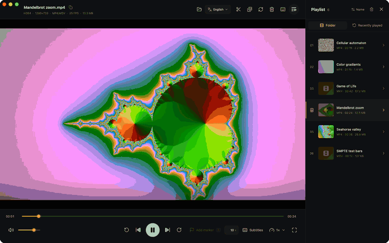

<div align="center">

# ▶ ViPlay

**A fast, keyboard-friendly desktop video player that also splits, previews, re-encodes, and cleans up your video folders.**

Built with Go, [Wails v3](https://v3.wails.io), and Vue 3 for macOS, Windows, and Linux.

[](https://github.com/ctengiz/viplay/releases/latest)
[](https://github.com/ctengiz/viplay/actions/workflows/build.yml)
[](LICENSE)
[](https://github.com/ctengiz/viplay/releases)
<br>
[](#-download)
[](go.mod)
[](https://v3.wails.io)
[](https://vuejs.org)
[](https://github.com/ctengiz/viplay/commits/main)
[](https://github.com/ctengiz/viplay/stargazers)


</div>

## 💡 Why ViPlay?

Most players stop at playback. ViPlay is built for **going through a folder of videos and deciding what to keep**, all without leaving the player:

| | ViPlay | Typical player |
| --- | :---: | :---: |
| Opens MKV, AVI, WMV, FLV, HEVC, AC3/DTS without conversion | ✅ | ✅ |
| The file's whole folder as a playlist with thumbnails, duration, and size | ✅ | ➖ |
| Lossless split at keyframes, in any number of parts | ✅ | ❌ |
| Contact sheet of evenly spaced frames | ✅ | ❌ |
| Re-encode to HEVC/AV1, verify the result, and trash the original | ✅ | ❌ |
| Delete the current video from disk with one key, even on network shares | ✅ | ❌ |
| Jump to the next or previous folder with `⌘→` / `⌘←` | ✅ | ❌ |

Watch → mark → split, preview, shrink, or delete → next video. That is the whole loop.

<div align="center">



</div>

## ✨ Features

### 🎬 Playback

- **Plays almost anything on macOS** through libmpv with hardware decoding: MKV, AVI, WMV, FLV, MPG, 10-bit HEVC, AC3/DTS audio, and more, with no conversion.
- **Legacy formats on Windows and Linux** (MPG/MPEG, FLV, AVI, WMV/ASF, MKV) play through cached FFmpeg compatibility proxies, created by remuxing first and re-encoding with hardware acceleration only when needed.
- Starts playing as soon as you open, drop, or double-click a file.
- Play/pause, adjustable seek step, previous/next, speed from 0.5× to 2×, volume, and mute.
- WebVTT subtitles: open a `.vtt` file or drop it onto the window.
- **Distraction-free fullscreen**: only the video fills the screen, controls appear when you hover over them, the cursor hides when idle, and on macOS the file name shows in the title bar when you move the pointer to the top of the screen.

### 📂 Library and playlist

- Opening a file loads its whole folder as a playlist, with thumbnails, duration, size, and format for every row.
- Sort by name, modified date, or duration.
- **Recently played** list one click away.
- Thumbnails are generated in the background, pause during playback, and can be paused, stopped, or cleared.
- Right-click a row to play it, show it in Finder or Explorer, or move it to the Trash.
- Move to the next or previous folder with `⌘→` / `⌘←`.
- Media details (codecs, resolution, container, FPS, size) under the file name, plus one-click full-path copy.
- Drag and drop files, or use Finder's **Open With** menu: ViPlay registers for MP4, M4V, MOV, WebM, MKV, AVI, WMV, ASF, MPG, MPEG, FLV, MP3, M4A, WAV, and FLAC.

### ✂️ Editing tools

- **Lossless splitting**: drop markers with `B` or by right-clicking the timeline, then split into any number of parts. FFmpeg copies the streams at the nearest keyframe without re-encoding, so it is fast and loses no quality.
- **Contact sheets**: a JPEG grid of up to 60 evenly spaced frames in four sizes, with timestamps when FFmpeg supports them.
- **Re-encoding** to MP4 (most compatible), HEVC (smaller), or AV1 (smallest) with the resolution and quality kept. The output is verified for codec, duration, and size before the original is moved to the Trash, which is optional, and you can cancel at any time.
- **Delete from disk** with `Del` / `⌘⌫`, including files on network shares. Files go to the Trash when the volume supports it and are deleted permanently otherwise.

Output files are written next to the source with collision-free names.

### 🌍 Built for everyone

- English and Turkish UI, switchable from the top bar and remembered between sessions.
- Readable, selectable error messages, including platform-specific FFmpeg install instructions when FFmpeg is missing.
- Local media is served only to the app through an authorized HTTP server with range requests.

## ⌨️ Keyboard shortcuts

| Key | Action |
| --- | --- |
| `Space` | Play / pause |
| `←` / `→` | Seek back / forward by the seek step |
| `B` | Add / remove a split marker |
| `F` / double-click | Toggle fullscreen |
| `Esc` | Leave fullscreen |
| `M` | Mute |
| `⌘←` / `⌘→` | Previous / next folder |
| `Del` / `⌘⌫` | Delete the current video |

## 📦 Download

Get the latest build from the [releases page](https://github.com/ctengiz/viplay/releases/latest).

| Platform | Media runtime |
| --- | --- |
| **macOS** | Self-contained: libmpv, FFmpeg, and ffprobe are bundled into `ViPlay.app`. |
| **Windows** | Install FFmpeg first: `winget install Gyan.FFmpeg`, then restart ViPlay. |
| **Linux** | Install `ffmpeg` with your distribution's package manager. |

On Windows and Linux, the system WebView's media engine decides which codecs play directly; H.264/AAC in MP4 works most widely, and FFmpeg covers the rest.

## 🛠️ Build from source

**Requirements**

- Go 1.26+ and Node.js 20+
- [Wails v3 platform dependencies](https://v3.wails.io/quick-start/installation/)
- macOS: `brew install mpv ffmpeg` (bundled into the app at packaging time)
- Windows / Linux: system `ffmpeg` and `ffprobe`

**Develop**

```bash
go install github.com/wailsapp/wails/v3/cmd/wails3@v3.0.0
cd frontend && npm install && cd ..
wails3 dev
```

**Package**

```bash
wails3 task package   # package for the current OS
wails3 task install   # macOS: install into /Applications and register for Open With
```

Artifacts are written to `bin/`. Each platform must be built on that platform; the CI matrix builds all three.

## 🌐 Localization

`locales/catalogs.json` is the only translation source. It is validated and embedded into the binary at build time, and the Go backend sends the selected catalog to Vue before the UI mounts. English is the default and fallback language.

To add a language, add its metadata and messages to the catalog; no component changes are needed. Every user-facing string must have matching English and Turkish keys, which `npm --prefix frontend run check:i18n` verifies.

## 📄 License

ViPlay is free software under the [GNU General Public License v3.0 or later](LICENSE). Bundled and compiled-in third-party components, their licenses, and how to obtain their source code are listed in [`THIRD_PARTY_NOTICES.md`](THIRD_PARTY_NOTICES.md).
