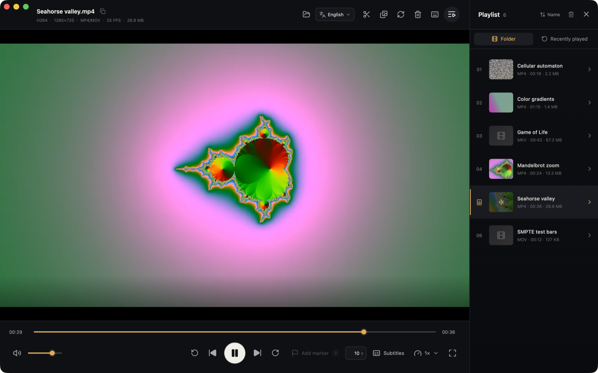

# ViPlay

ViPlay is a cross-platform desktop video player built with Go, Wails v3, and Vue 3 for macOS, Linux, and Windows.



## Requirements

- Go 1.26+
- Node.js 20+
- Wails platform dependencies: https://wails.io/docs/gettingstarted/installation
- macOS builds: Homebrew `mpv` and `ffmpeg` (`brew install mpv ffmpeg`); packaging bundles them into `ViPlay.app`
- Windows and Linux: system-installed `ffmpeg` and `ffprobe` for legacy-format playback, video splitting, contact sheets, and re-encoding

Packaged macOS builds are self-contained: libmpv plays every format directly, and the bundled FFmpeg handles splitting, contact sheets, and re-encoding. On Windows and Linux, install FFmpeg with `winget install Gyan.FFmpeg` or the distribution package manager and restart ViPlay.

## Development

```bash
go install github.com/wailsapp/wails/v3/cmd/wails3@v3.0.0
cd frontend && npm install && cd ..
wails3 dev
```

## Build

For the active operating system:

```bash
wails3 task package
```

On macOS, install the packaged app into `/Applications` and register it for Finder's **Open With** menu:

```bash
wails3 task install
```

Distribution artifacts are written under `bin`. Windows builds must run on Windows, macOS application bundles on macOS, and Linux packages on Linux; the CI matrix covers all three platforms.

## Localization

English is the default and fallback language. Turkish is included and can be selected from the application header; the choice persists between sessions. Vue loads the selected messages from the Go backend before mounting.

- Single localization source: `locales/catalogs.json`
- Embedded loading and backend translation: `i18n.go`
- Frontend loading and interpolation: `frontend/src/i18n.js`

Every user-facing feature must include matching English and Turkish translation keys in the shared JSON file. The catalog is validated and embedded into the application binary at build time. Add another language by adding its metadata and messages there; application components should not require changes.

## Features

- Multi-file local playback queue
- Play/pause, seeking, previous/next navigation, playback speed, volume, and fullscreen
- macOS playback through libmpv with hardware decoding, opening MKV, AVI, WMV, FLV, MPG, HEVC, and AC3/DTS audio directly
- Windows and Linux playback of MPG, MPEG, FLV, AVI, WMV, and MKV through cached FFmpeg-generated compatibility proxies
- WebVTT subtitle loading
- Keyboard shortcuts: `Space`, `←`, `→`, `F`, `M`, `⌘←` / `⌘→` for folder navigation, and `Del` / `⌘⌫` for disk deletion
- Lossless FFmpeg stream-copy splitting at keyframes; place split markers with `B` or by right-clicking the timeline, then split into parts from the marker bar
- FFmpeg contact-sheet generation
- Video/audio codec, container, dimensions, FPS, and file-size information
- Authorized local media streaming with HTTP range requests
- Persistent English and Turkish UI

On Windows and Linux, codec playback support depends on the operating system WebView media engine. H.264/AAC in MP4 provides the broadest common compatibility.

## License

ViPlay is free software licensed under the GNU General Public License v3.0 or later (`GPL-3.0-or-later`); see `LICENSE`. Bundled and compiled-in third-party components, their licenses, and how to obtain their corresponding source are listed in `THIRD_PARTY_NOTICES.md`.
